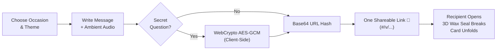

<div align="center">

# 🕊️ Kabootar

**Send a *feeling*, not just a text.**

Animated greeting cards & interactive secret links living inside a single URL fragment.  
**No server. No database. No accounts. 100% client-side.**

[](https://madb0i.github.io/kabootar/)
[](LICENSE)
[-4ecdc4?style=for-the-badge)](#-how-it-works)
[](#-security--privacy)

---

</div>

## ✨ What makes Kabootar special?

- 💌 **Wax-Seal Opening Ceremony** — A 3D airmail envelope with an authentic wax seal. Tapping the seal breaks it with tactile sound and haptics, sliding the folded letter into the story deck.
- 🪙 **Interactive Scratch Cards** — A shimmering metallic foil card you can scratch with your finger or mouse to reveal hidden confessions and surprises.
- 📸 **1-Click Story Cards & QR Codes** — Download high-resolution 9:16 vertical cards with embedded scannable QR codes ready to post on Instagram Stories or WhatsApp Status.
- 🎧 **Generative Web Audio Synthesizer** — Zero external audio files. Generates ambient Lo-Fi chords, celestial music box melodies, and tactile SFX (wax crack, candle blow, fireworks) using pure browser Web Audio.
- 🔒 **Encrypted Secret Questions** — Lock any card with client-side **PBKDF2 + AES-GCM**. The payload is ciphertext; only the recipient with the right answer can decrypt it.
- 🎭 **Interactive Mini-Games & Scenes**:
  - **Sorry**: Runaway *"Nahi"* button that dodges the cursor until they forgive you.
  - **Birthday**: 3D cake with candles you can blow out via microphone or tap.
  - **Crush & Secret**: Metallic gold scratch foil confession.
  - **Bestie Roast**: An interactive *"Chaos / Unhinged Meter"* for playful banter.
  - **Romantic**: Shimmering night sky stars that assemble into the recipient's name.
  - **Chai Date**: Steaming cutting chai glass with tap-to-brew heart steam.
  - **New Year**: Interactive midnight fireworks with click-to-burst particles.
- 🇮🇳 **Culturally Rich Templates** — Diwali, Eid, Bihu, Rakhi, Karwa Chauth, Anniversary, Birthday, Sorry, and Custom cards out of the box.

---

## 🚀 How it works

Kabootar is **serverless by design**. The link *is* the message.



All data travels safely in the URL fragment (`window.location.hash`). Nothing is ever sent to a remote server.

---

## 🛠️ Tech Stack

- **Framework**: [React 19](https://react.dev/) + [Vite 8](https://vitejs.dev/)
- **Styling**: [Tailwind CSS v4](https://tailwindcss.com/)
- **Motion & 3D Gestures**: [Framer Motion](https://www.framer.com/motion/)
- **Sound Design**: Native Web Audio API (100% offline, procedural sound synthesis)
- **Cryptography**: Web Crypto API (PBKDF2 with 200,000 iterations + AES-GCM 256-bit)
- **Offline / PWA**: Service Worker with offline caching & installable web app manifest
- **Deployment**: Automated GitHub Pages workflow

---

## ⚡ Quickstart

Run your own instance locally in seconds:

```bash
# Clone the repository
git clone https://github.com/MadB0i/kabootar.git
cd kabootar

# Install dependencies
npm install

# Start local dev server
npm run dev
```

Visit `http://localhost:5173/kabootar/` in your browser.

### Building for Production

```bash
npm run build
npm run preview
```

---

## 🔒 Security & Privacy

- **Zero Tracking**: No cookies, no third-party trackers, no analytics.
- **Zero Server Storage**: No database or backend API exists. If you lose the link, the message cannot be recovered.
- **End-to-End Client Encryption**: When a secret question is enabled, the plaintext is encrypted with AES-GCM using a key derived from the answer via PBKDF2.

---

## 📄 License

Distributed under the **MIT License**. See [`LICENSE`](LICENSE) for details.

Made with 🕊️ by [MadB0i](https://github.com/MadB0i).
