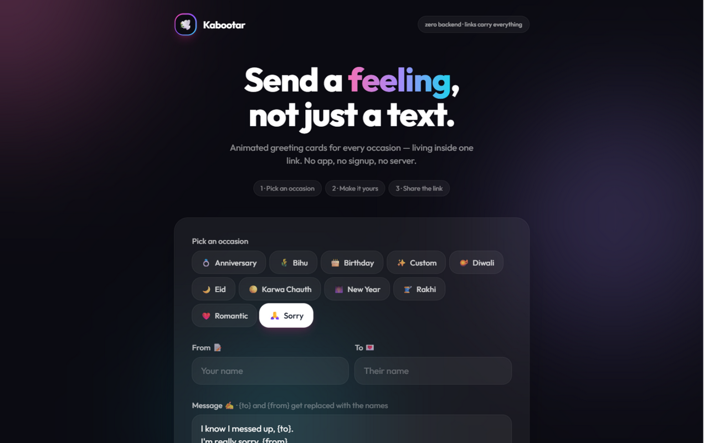
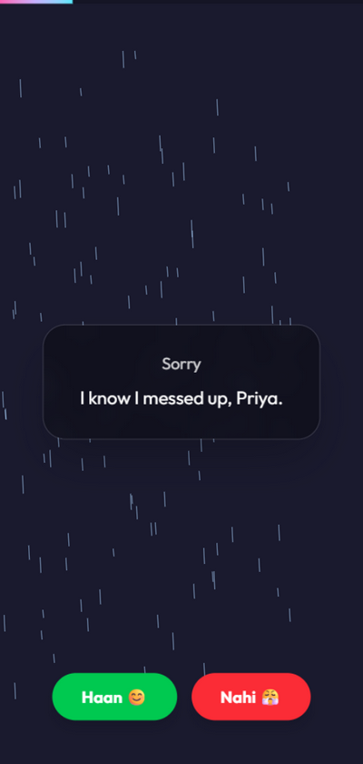
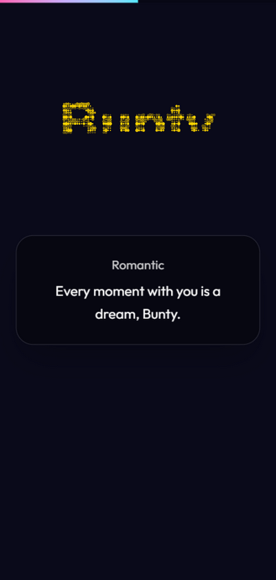
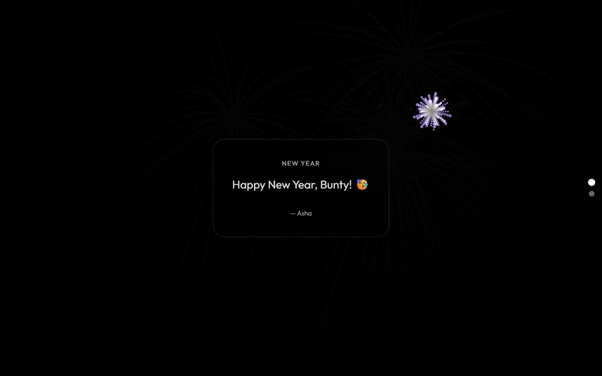
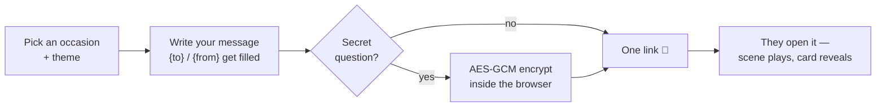

<div align="center">

# 🕊️ Kabootar

**Send a *feeling*, not just a text.**

Animated greeting cards for every occasion — living inside **one link**.
No app. No signup. No server. No tracking.

[](https://github.com/madb0i/kabootar/actions/workflows/deploy.yml)
[](LICENSE)
[](CONTRIBUTING.md)
[](#privacy)

**[🎉 Open the live demo →](https://madb0i.github.io/kabootar/)**



*[Interactive rain scene — mobile](docs/screenshots/sorry-mobile.png) · [Star-formed names](docs/screenshots/romantic-mobile.png) · [Fireworks](docs/screenshots/newyear.png)*

<p>
  
  
  
</p>

</div>

## ✨ Why this is different

- **Zero backend.** Your message never touches a server — it's encoded directly in the link hash. The link *is* the message.
- **Encrypted secret questions.** Lock a card behind PBKDF2 + AES-GCM — the payload is ciphertext; only the right answer decrypts it, right in the browser.
- **Interactive scenes.** A runaway "Nahi" button, birthday candles you can actually blow out (mic or tap), stars that assemble into a name, fireworks for the new year.
- **India-first occasions.** Bihu (with Assamese messages), Diwali, Eid, Rakhi, Karwa Chauth out of the box — plus Sorry, Romantic, Birthday, New Year, Anniversary.
- **Installable + offline.** PWA manifest and an offline shell — once you've opened a card, it keeps working without a network.
- **Motion with manners.** Full framer-motion transitions that switch themselves off for `prefers-reduced-motion`.

## 🚀 How it works



Everything (names, message, theme, scene, the encrypted secret) travels **inside the URL fragment**. Nothing is ever uploaded.

## 🎁 Features

| Feature | Details |
|---|---|
| Occasions | Sorry, Romantic, Birthday, New Year, Anniversary, Custom + Bihu, Diwali, Eid, Rakhi, Karwa Chauth |
| Themes | Per-occasion gradient palettes with a live preview while you type |
| Animations | Floating particles, confetti, fireworks, petals, stars — toggle off anytime |
| Time locks | Soft unlock-at date/time with a live countdown |
| Secret questions | Web Crypto (PBKDF2 + AES-GCM) encrypted payload behind a question |
| Music | Optional background audio — never autoplays, one-tap toggle |
| Mobile & desktop | Swipeable cards on mobile, scroll-snapped scenes with dots + keyboard on desktop |
| Reply loop | One-tap WhatsApp reply and a "Make your own" CTA on every card |
| Share | Native share sheet on mobile, copy-with-confetti everywhere else |

## 🛠️ Tech stack

- **Vite 8** + **React 19** + **Tailwind CSS v4** (`@tailwindcss/vite`)
- **Framer Motion** — card transitions and reveals
- **Web Crypto API** — PBKDF2 (200k iterations) + AES-GCM, zero libraries
- **Hash-based routing** (`#/`, `#/v/<data>`) — no router, works from any static host
- **Canvas scenes** — DPR-aware, ResizeObserver-driven, single rAF loop each
- **PWA** — manifest + tiny service worker (network-first shell, cache-first assets)

## 🧞 Add your own occasion

See [`docs/ADD_OCCASION.md`](docs/ADD_OCCASION.md). Drop one JS file into `src/templates/` — it registers itself.

## 🌍 Self-host

1. Fork the repo.
2. **Settings → Pages → Source: GitHub Actions**.
3. Push to `main`. The [deploy workflow](.github/workflows/deploy.yml) builds with `npm ci && npm run build` and publishes `dist/`.
4. Done — your instance is live at `https://<you>.github.io/kabootar/`.

Or run it locally:

```bash
npm ci
npm run dev
```

## 🔒 Privacy

Your message exists **only inside the URL**. Nothing is sent to any server — there isn't one. Secret-question encryption runs entirely in your browser via the Web Crypto API. No analytics, no cookies, no accounts.

## 📄 License

[MIT](LICENSE) · Contributions welcome — see [CONTRIBUTING.md](CONTRIBUTING.md).
